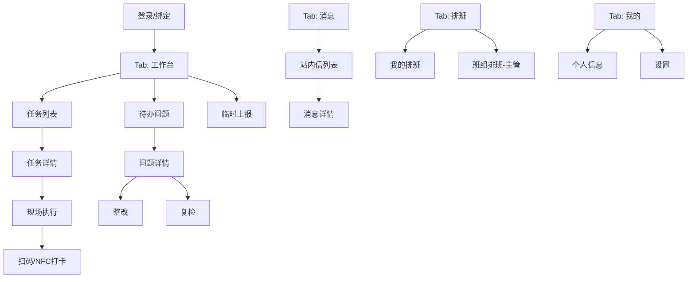
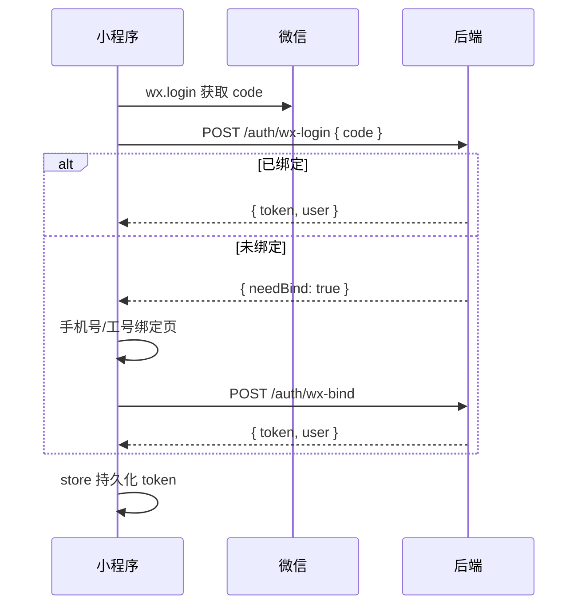

# 微信小程序整体框架设计

## 技术选型

| 项 | 选择 | 说明 |
|----|------|------|
| 框架 | 原生微信小程序 | 便于 NFC、扫码、订阅消息等能力 |
| 语言 | TypeScript（推荐）/ JS | 本仓库 scaffold 使用 JS，可渐进迁移 |
| 状态 | 页面 data + `store/session.js` | 用户信息、Token、未读数 |
| 网络 | `services/request.js` 统一封装 | JWT + 错误码 + 401 跳登录 |
| UI | 自定义组件 + CSS 变量 | 对齐 PC 品牌色 `#1A5FDB` |
| 分包 | `packages/patrol` | 巡查管控主业务，控制主包体积 |

## 页面信息架构



## TabBar 配置（一期）

| Tab | 路径 | 徽章 |
|-----|------|------|
| 工作台 | `pages/workbench/index` | 待办总数 |
| 消息 | `pages/message/index` | 未读数 |
| 排班 | `pages/schedule/index` | — |
| 我的 | `pages/mine/index` | — |

## 分包：巡查管控 `packages/patrol`

| 页面 | 路径 | 功能 |
|------|------|------|
| 任务列表 | `task-list` | 筛选：今日/待办/已完成/已超时 |
| 任务详情 | `task-detail` | 计划信息、子项列表、进度 |
| 现场执行 | `subtask-onsite` | 巡更点卡片、顺序控制 |
| 扫码打卡 | `guard-scan` | 校验点位、提交打卡 |
| 远程执行 | `subtask-remote` | 轻量填报（可选） |
| 问题列表 | `issue-list` | 我相关的全部问题 |
| 问题详情 | `issue-detail` | 时间线、附件 |
| 临时上报 | `issue-report` | 选对象/巡检项、描述、附件 |
| 整改 | `issue-rectify` | 处理人提交整改 |
| 现场复检 | `issue-reinspect-onsite` | 关联巡更点打卡 |

## 公共组件

| 组件 | 用途 |
|------|------|
| `nav-bar` | 自定义导航栏 |
| `status-tag` | 待完成/已完成/已超时/待整改… |
| `empty-state` | 空列表 |
| `upload-media` | 图片/视频选择上传 |
| `voice-input` | 语音描述（对接微信录音 + ASR） |
| `guard-point-card` | 巡更点打卡卡片 |
| `progress-bar` | 打卡进度 |
| `timeline` | 问题流转时间线 |

## 核心服务层 `services/`

```
services/
├── request.js       # 基址、Token、拦截器
├── auth.js          # wx.login + 绑定平台账号
├── patrol-task.js   # 任务 CRUD、子项、打卡
├── patrol-issue.js  # 问题提报/整改/复检
├── schedule.js      # 排班查询
├── message.js       # 站内信
└── upload.js        # 文件上传 OSS/MinIO
```

## 鉴权流程



## 离线与时序

- 打卡提交：**在线优先**；弱网时写入本地队列，恢复后重试（`utils/offline-queue.js`）
- 巡更点顺序：服务端校验「依次打卡」时上一节点是否已完成
- 定位（可选）：提交打卡时附带 `latitude/longitude` 供围栏校验

## 与 PC 演示数据对齐

开发阶段 `mock/` 目录复用 PC 演示语义：

- 计划 `PL-2026-002` → 班组 `BZ-002` 按周排班
- 计划 `PL-2026-003` → 假日跳过 `HD-001`
- 子项问题处理人来自 `planItemHandlers`，**不**回退值班人
- 任务执行人来自固定用户或**当日班组值班人**
