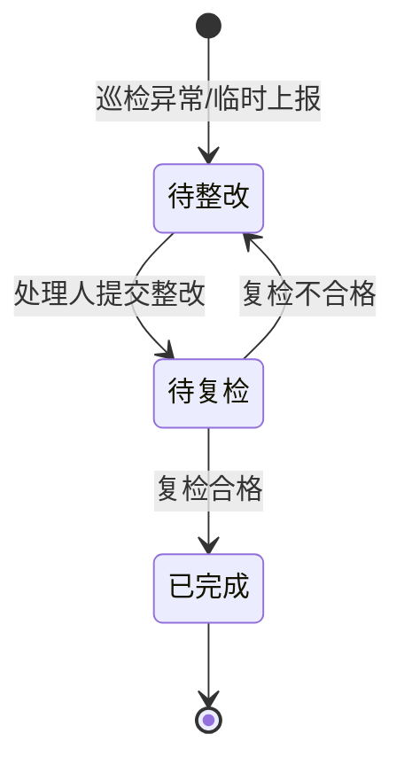

# 巡查管控 · 移动端功能详设（重点）

对齐 PC 端 `patrol-control.js` / `04-patrol-control.html` 业务规则，在小程序中完整实现一线作业闭环。

---

## 1. 工作台

### 1.1 概览卡片

| 卡片 | 统计规则 | 点击跳转 |
|------|----------|----------|
| 今日任务 | `scheduled` 日期 = 今天 且 执行人=我 | 任务列表·今日 |
| 待巡检 | 状态 ∈ {待完成} 且 执行人=我 | 任务列表·待办 |
| 已超时 | 状态 = 已超时 且 执行人=我 | 任务列表·已超时 |
| 待整改 | 问题处理人=我 且 状态=待整改 | 问题列表 |
| 待复检 | 创建人=我 且 状态=待复检 | 问题列表 |

### 1.2 执行人解析（与 PC 一致）

```
若计划 executorSource = schedule：
  executorId = getGuardScheduleDutyUserId(scheduleConfig, 任务计划开始日)
否则：
  executorId = plan.executorId
```

班组循环/按周/按月排班算法与 PC `getGuardScheduleDutyUserId` 保持一致。

### 1.3 快捷入口

- 扫码巡检（扫巡更点标签直接进入打卡，若当日有含该点的待执行任务则关联）
- 临时问题上报
- 催办消息（只读跳转对应任务）

---

## 2. 巡检任务

### 2.1 任务列表

**筛选：** 全部 / 今日 / 待完成 / 已完成 / 已超时

**列表项字段：**

- 计划名称、巡检对象、计划开始时间
- 进度 `doneCount/total`
- 状态标签

**排序：** 待完成优先 → 计划时间升序 → 已超时置顶

**下拉刷新 + 分页**

### 2.2 任务详情

| 区块 | 内容 |
|------|------|
| 基本信息 | 任务编号、计划名称、对象、计划开始/完成时间、状态 |
| 执行人 | 当前执行人（转派后显示新人） |
| 子巡检项 | 表格：编号、名称、方法、问题处理人、状态、操作 |

**子项操作矩阵：**

| 检查方法 | 状态 | 操作 |
|----------|------|------|
| 现场 | 待完成/已超时 | **去执行** |
| 现场 | 已完成 | 查看结果 / 查看问题 |
| 远程 | 待完成 | **去执行**（轻量）或提示 PC 看监控 |
| 远程 | 已完成 | 查看结果 |
| 自动 | 任意 | 只读，展示系统自动分析结果 |

**转派：** PC 发起；小程序仅展示「已由 XXX 转派给您，进度已继承」

---

## 3. 现场巡检执行（核心）

### 3.1 页面结构 `subtask-onsite`

```
┌─────────────────────────────┐
│ 巡检项：机房环境检查          │
│ 方法：现场  顺序：依次打卡     │
│ 进度 ████░░  2/3             │
├─────────────────────────────┤
│ [1] GP-002 机房入口  已打卡   │
│ [2] GP-004 配电间    进行中 ← │
│ [3] GP-005 UPS间    未解锁   │
└─────────────────────────────┘
```

### 3.2 巡更点卡片状态

| 状态 | 条件 | UI |
|------|------|-----|
| 未解锁 | 依次模式下前序未完成 | 灰色，不可点 |
| 待打卡 | 可执行 | 高亮，进入打卡页 |
| 已打卡 | 有 `guardPointResults[pointId]` | 展示结果摘要 |

### 3.3 打卡页 `guard-scan`

**进入方式：**

1. 从执行页点击巡更点
2. 工作台「扫码巡检」
3. NFC 碰一碰（Android）

**打卡方式（由巡更点 `guardPointType` 决定）：**

| 类型 | 小程序实现 |
|------|------------|
| 二维码 | `wx.scanCode` → 校验 `pointId` |
| NFC标签 | `wx.getNFCAdapter` 读标签 ID |
| 门禁 | 调后端「门禁通行事件」或手动确认（需对接） |

**提交表单（对齐 PC `submitPatrolGuardPointResult`）：**

| 字段 | 必填 | 说明 |
|------|------|------|
| result | 是 | 正常 / 异常 |
| remark | 否 | 备注 |
| issueDesc | 异常时必填 | 文字描述 |
| issueDescVoice | 否 | 语音 URL + 时长 |
| images | 否 | 现场照片 |
| attachments | 否 | 视频等 |

**提交后：**

- 写入 `guardCheckins[pointId] = 打卡时间`
- 写入 `guardPointResults[pointId]`
- 若异常 → 自动创建问题（`source=现场巡检`），处理人=计划中该巡检项的 `issueHandlerId`
- 全部点位完成 → 子项状态 **已完成**，刷新任务进度

### 3.4 顺序规则

- `orderMode = sequential`：仅允许打卡「下一个未完成点」
- `orderMode = random`：任意未完成点均可打卡
- 路线模式（`sourceMode=route`）：点位顺序来自路线 `pointIds`

---

## 4. 问题管理

### 4.1 问题生命周期



### 4.2 临时上报 `issue-report`

| 步骤 | 字段 |
|------|------|
| 1 | 关联巡检对象（必选） |
| 2 | 关联巡检项（必选） |
| 3 | 问题描述（文字/语音） |
| 4 | 图片/视频附件 |
| 5 | 问题处理人（必选，来自组织用户） |

来源标记：`临时上报`；创建人=当前用户。

### 4.3 整改 `issue-rectify`

- 仅 `patrolIssueHandler` 可操作
- 状态须为 **待整改**
- 提交：整改说明、附件 → 状态 **待复检**，通知创建人

### 4.4 复检

**现场巡检问题 `issue-reinspect-onsite`：**

- 列出 `patrolIssueGuardPoints` 关联巡更点
- 逐点 **打卡复检**（仅记录打卡时间，不填巡检结果表单）
- 全部打卡后允许提交 → **已完成**
- 与 PC 一致：PC 不可提交，仅小程序可完成现场复检

**远程/自动问题：**

- 展示系统 AI/监控复检结论
- 创建人确认 **合格/不合格**

---

## 5. 排班查询

### 5.1 我的排班 `schedule/index`

| 视图 | 内容 |
|------|------|
| 今日 | 当前用户是否值班、所属班组 |
| 周历 | 7 天值班标记 |
| 月历 | 当月值班日高亮 |

数据来源：用户所属班组 `guardScheduleConfig` + `getGuardScheduleDutyUserId`。

### 5.2 班组排班（主管可选）

- 只读查看班组「最近一月排班预览」（同 PC 导出逻辑）
- 无编辑权限

---

## 6. 站内信

PC 端计划仅配置 `remindChannel`（站内信/短信）；**小程序实现站内信收件箱**。

### 6.1 消息类型

| type | 触发 | 跳转 |
|------|------|------|
| `task_remind` | 计划提醒（任务开始前 N 分钟） | 任务详情 |
| `task_overdue` | 任务超时 | 任务详情 |
| `task_urge` | PC 催办 | 任务详情 |
| `issue_assigned` | 新问题指派整改 | 问题详情 |
| `issue_reinspect` | 待复检 | 问题详情 |
| `task_reassign` | 任务转派 | 任务详情 |

### 6.2 列表能力

- 未读/全部
- 标记已读、全部已读
- 微信订阅消息（可选，与站内信并行）

---

## 7. 页面线框与路由

| 路由 | 标题 |
|------|------|
| `/pages/workbench/index` | 工作台 |
| `/packages/patrol/task-list/index` | 巡检任务 |
| `/packages/patrol/task-detail/index?taskId=` | 任务详情 |
| `/packages/patrol/subtask-onsite/index?taskId=&subtaskCode=` | 现场执行 |
| `/packages/patrol/guard-scan/index?taskId=&subtaskCode=&pointId=` | 巡更打卡 |
| `/packages/patrol/issue-report/index` | 临时上报 |
| `/packages/patrol/issue-detail/index?issueNo=` | 问题详情 |
| `/packages/patrol/issue-rectify/index?issueNo=` | 问题整改 |
| `/packages/patrol/issue-reinspect-onsite/index?issueNo=` | 现场复检 |
| `/pages/schedule/index` | 排班查询 |
| `/pages/message/index` | 站内信 |

---

## 8. 非功能需求

| 项 | 要求 |
|----|------|
| 性能 | 任务列表首屏 < 1.5s（4G） |
| 安全 | HTTPS、Token 过期刷新、敏感操作二次确认 |
| 审计 | 打卡/整改/复检提交带 `deviceInfo`、可选 GPS |
| 兼容 | 基础库 ≥ 2.25.0；NFC 功能检测后降级为扫码 |

---

## 9. 与 PC 演示数据对照测试用例

| 用例 | 预期 |
|------|------|
| 用户=张三，周六打开 PL-2026-002 任务 | 执行人为陈六（班组按周排班） |
| PL-2026-003 在端午节 | 不生成/不展示任务 |
| PI-005 子项异常 | 问题处理人=李四（planItemHandlers），非值班人 |
| 现场问题待复检 | 仅小程序可打卡完成复检 |
